# SFTPgate — High-Level Design

Status: Draft for review · Companion to [PRD](PRD.md) · Detail in [LLD](LLD.md)

## 0. Who touches SFTPgate

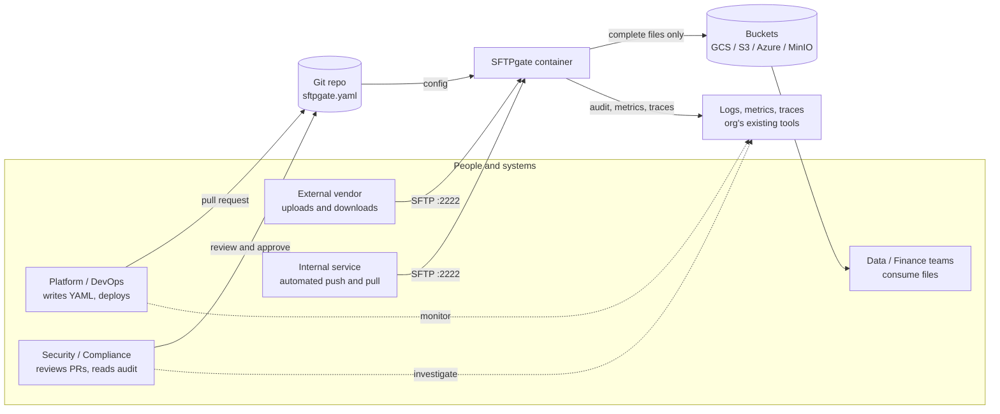

| Persona | Touches | Never touches |
|---|---|---|
| Platform / DevOps | Git (YAML), deployment, dashboards | Partner passwords in plaintext |
| Security / Compliance | PR reviews, audit logs, dashboards | Runtime config (there is no runtime edit) |
| Vendor / internal service | SFTP endpoint, only their folders | Shell, other folders, the bucket directly |
| Data / Finance | The bucket | SFTPgate itself |

## 1. Architecture at a glance

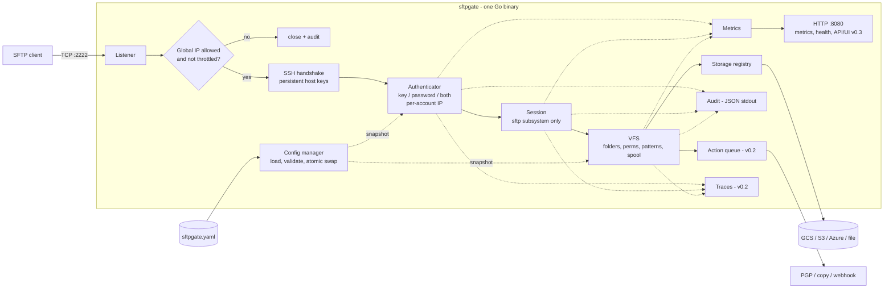

## 2. Key design decisions

| # | Decision | Why | Alternatives rejected |
|---|---|---|---|
| D1 | **Go, single static binary** | Strong SSH/SFTP libraries, easy static builds, low memory, one artifact. | Rust (smaller SFTP server ecosystem), Java (heavier runtime). |
| D2 | **`golang.org/x/crypto/ssh` + `github.com/pkg/sftp` RequestServer** | Battle-tested protocol code. We only implement handlers. | Writing our own protocol code (risky, large). Wrapping OpenSSH (needs Unix users, cannot map to buckets cleanly). |
| D3 | **`gocloud.dev/blob` for all storage** | One interface and one URL format for GCS/S3/Azure/MinIO/local. Built-in in-memory backend for tests. | Separate SDK integrations per cloud (3× the code). |
| D4 | **Uploads spool to local disk, then commit to storage on close** | Object storage cannot do random writes. Commit-on-close guarantees no partial files downstream. Lets us compute SHA-256 and enforce size limits. | Streaming directly to object storage (breaks clients that write out of order, and exposes partial objects for multipart failures). |
| D5 | **No database** | State lives in git (config), storage (files), stdout (audit) and a small on-disk queue (actions). Nothing to back up, migrate or secure. | Postgres/SQLite (operational burden for little benefit). |
| D6 | **Audit = structured JSON to stdout** | Container-native. Docker, k8s, Loki, Cloud Logging and others already collect stdout. For tamper resistance, ship to a retention-locked bucket. | Built-in hash chain (only weak tamper evidence, since the whole file can be rewritten). Own log shipping. |
| D7 | **Config is an immutable snapshot swapped atomically** | Lock-free reads, simple reasoning, safe reload. | Mutable config with locks. |
| D8 | **Reload by polling the file hash + SIGHUP** | Works with k8s ConfigMap symlink swaps and Docker bind mounts. No fsnotify edge cases. | fsnotify (unreliable with atomic symlink swaps). |
| D9 | **GitOps via `git-sync` sidecar, not a built-in git client** | Zero code. Standard and well-maintained tool. Handles auth, SSH keys and branches. | Embedding go-git (large dependency, auth and credential handling becomes our problem). |
| D10 | **Read-only UI served by the same binary from embedded HTML templates** | No JS build chain and no second service. Read-only by construction (GET handlers only). | React SPA (build tooling and attack surface for a status page). |
| D11 | **Durable action queue = JSON files in a spool directory** | Survives restarts with ~50 lines of code. Visible and debuggable. | Redis/NATS/DB (new infrastructure). |
| D12 | **Traces via standard OTel env vars only** | Zero config surface. Off by default, at zero cost. | Tracing settings in YAML. |

## 3. Components

### 3.1 Config manager
- Loads YAML, resolves `${env:}`/`${file:}` references (after parsing, so values can't inject YAML structure), applies defaults and validates.
- Produces an immutable `*Config` snapshot. Holds it in an `atomic.Pointer`.
- Watches the file every `reload_interval` (default 10 s) by content hash, and on SIGHUP.
- On a successful reload: swap the snapshot, emit an audit event and a metric, then close sessions whose account was removed or changed.
- On a failed reload: keep the old snapshot, log the error, increment `config_reload_total{result="error"}`.

### 3.2 SSH listener and IP filter
- Accepts TCP. Before any SSH bytes, checks the remote IP against the **global** allowlist (if set) and the **throttle** blocklist. Rejected connections are closed immediately and audited.
- Performs the SSH handshake with persistent host keys and default modern algorithms.

### 3.3 Authenticator
- Looks up the account by SSH username in the current snapshot.
- Checks the **per-account** IP allowlist.
- Public key: compares the key against the account's keys (constant-time match on marshaled bytes).
- Password: bcrypt compare. To avoid username enumeration, also runs bcrypt against a dummy hash for unknown users.
- Mode `all`: a successful key returns `ssh.PartialSuccessError`, and the server then asks for a password.
- Failures feed the throttle (per IP). Every attempt is audited.

### 3.4 Session handler
- Accepts only `session` channels and only the `sftp` subsystem request. Rejects `exec`, `shell`, `pty-req`, and all forwarding and global requests.
- Starts a `pkg/sftp` RequestServer with handlers bound to (account, folders, session ID, remote IP).
- Tracks active sessions in a registry used by limits, reload, metrics and the UI.

### 3.5 VFS (virtual filesystem)
- Maps SFTP paths to `(folder, storage, object key)`. The root `/` lists the account's folders and is read-only.
- Enforces permissions, filename patterns and size limits on every operation.
- Read: range reads from object storage, with the reader reused for sequential access.
- Write: spool file, then on close compute SHA-256, upload to storage with metadata, delete the spool file, emit audit, and enqueue actions.
- Rename = copy + delete within the same folder storage. Mkdir = zero-byte `dir/` marker. Setstat (chmod, mtime) is accepted and ignored, for client compatibility.

### 3.6 Storage
- A registry of opened `*blob.Bucket` per named storage, opened at startup and on reload (only changed ones are reopened).
- `/readyz` checks that each bucket is reachable (cached, 30 s).

### 3.7 Audit, metrics, traces
- `audit.Emit(Event)` writes one JSON line through `log/slog`'s JSON handler to stdout (and an optional file).
- Prometheus collectors are registered once. Label cardinality is bounded (account and folder names come from config, never from IPs or file paths).
- OpenTelemetry tracer (v0.2) is a no-op unless `OTEL_EXPORTER_OTLP_ENDPOINT` is set.

### 3.8 Action runner (v0.2)
- After a committed upload, writes a job file `queue/<id>.json`. N workers process jobs, run the actions of the folder's or transfer's `after_*` hook in order (v0.4: named `actions:` run from `hooks:`; `before_*` hooks run synchronously and can refuse a file), and retry with exponential backoff. On success the job file is deleted. After `max_attempts` it moves to `queue/failed/`.
- Steps read from the landing object and write to new objects. The landing object is never modified.
- Pending jobs are re-enqueued on startup.

### 3.9 Scheduler (v0.3)
- Cron expressions per job. Each run uses a `pkg/sftp` client with a pinned remote host key, and streams between remote and storage.
- Single-instance assumption. For HA deployments, scheduling is enabled on one replica only (`jobs.enabled`).

### 3.10 Web (HTTP :8080)
- `/metrics`, `/healthz`, `/readyz`: unauthenticated (meant for internal networks only).
- `/api/v1/*`, `/ui/*` (v0.3): bearer token (`http.tokens` from env/file), GET only. Data comes from the session registry and an in-memory ring buffer of recent events. Long-term history is in the audit log, by design.

## 4. Key flows

### 4.1 Connect and authenticate

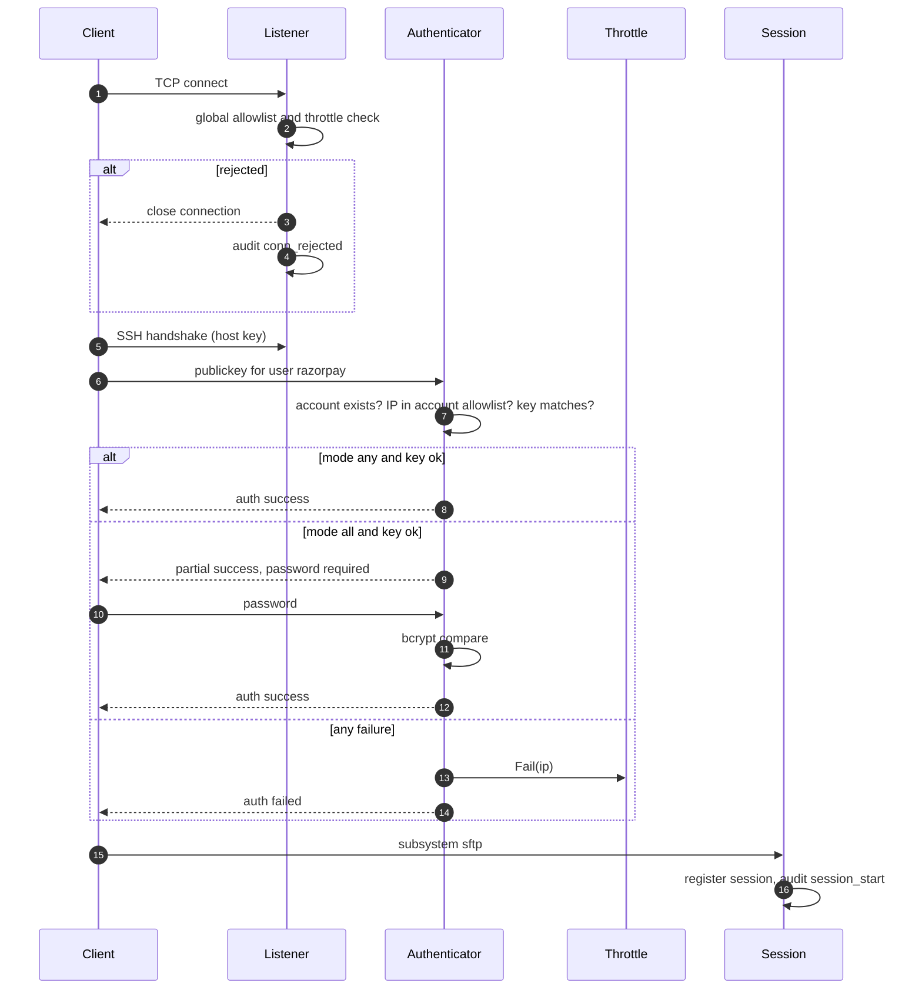

### 4.2 Upload (the critical path)

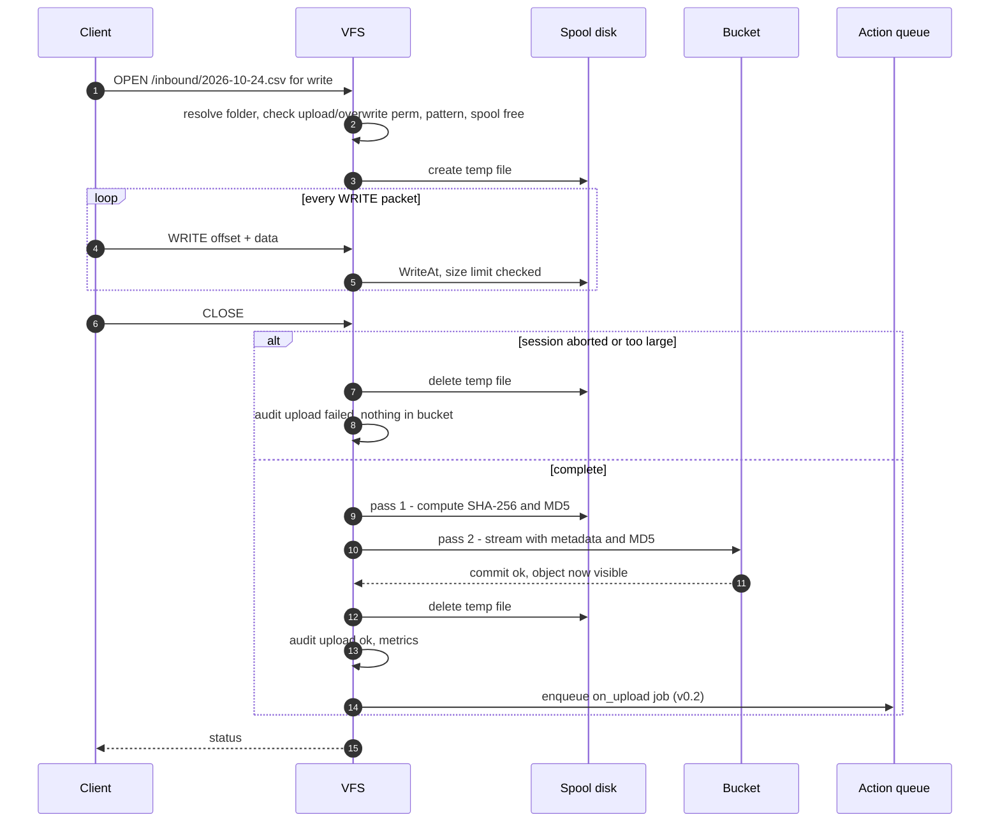

### 4.3 Download

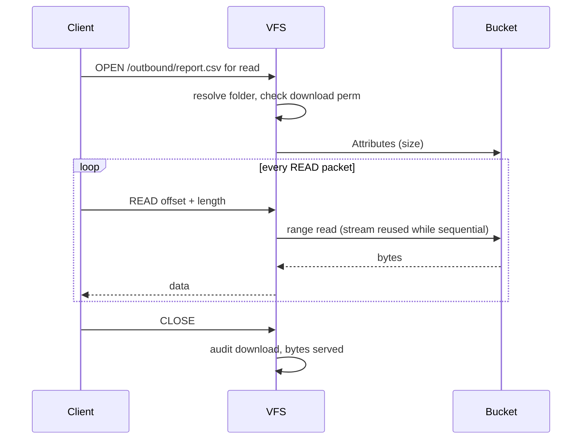

### 4.4 Config reload

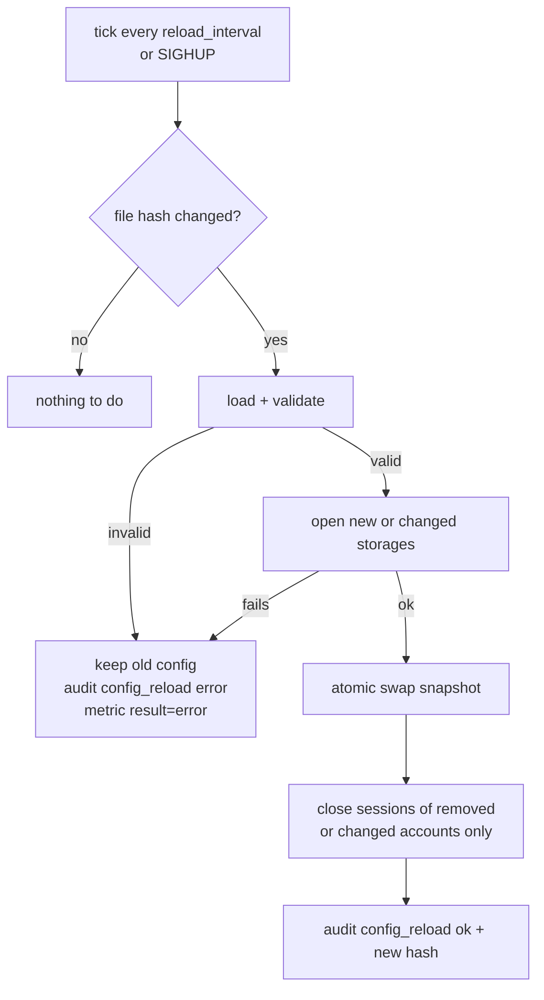

### 4.5 GitOps change (onboarding a vendor)

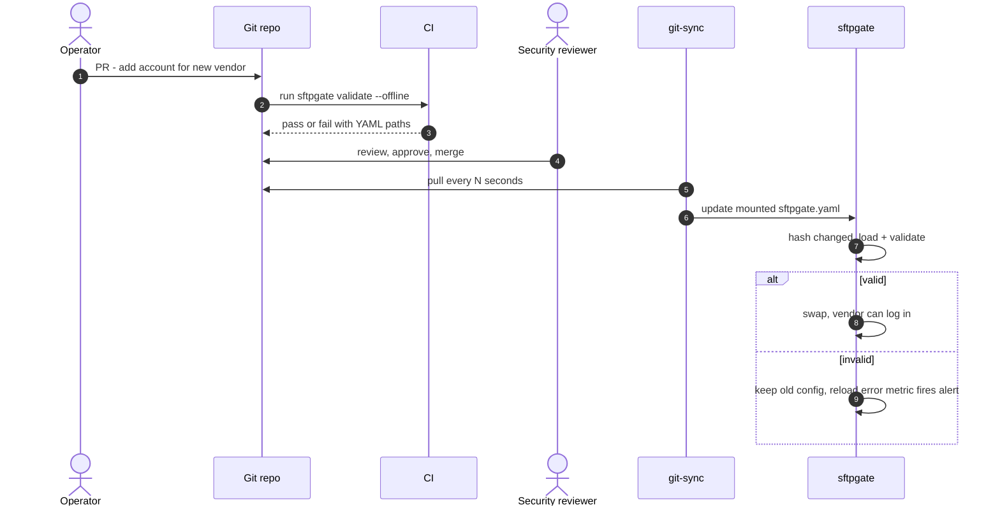

## 5. Deployment

### 5.1 Docker Compose (reference and test environment)

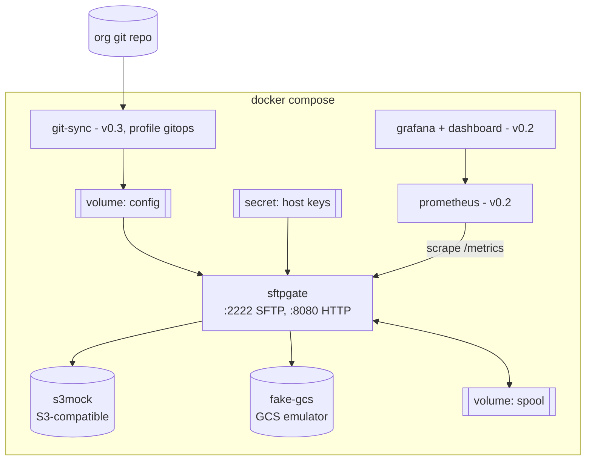

The same image and the same config format are used in every environment. Only the YAML values (storage URLs, accounts) differ per environment, e.g. `config/dev.yaml`, `config/prod.yaml` in the org's repo.

### 5.2 Kubernetes (documented, not packaged in v0.1)

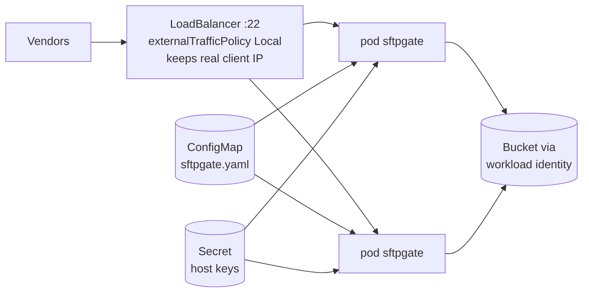

### 5.3 Scaling and HA
- Stateless apart from the spool (in-flight uploads) and the action queue. Multiple replicas behind a TCP load balancer work if they share the host-key secret.
- Action queue in multi-replica setups: each replica processes its own queue (job files are local). Acceptable, because jobs are created by the replica that received the upload.
- Client IP must be preserved by the load balancer. PROXY protocol support is a possible later addition, only if needed.

## 6. Security model

Every connection passes these gates in order. Failing any gate ends the connection or denies the operation, and the failure is audited.

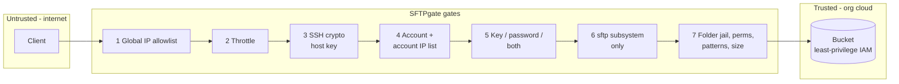

| Threat | Control |
|---|---|
| Brute force / credential stuffing | Global and per-account IP allowlists, per-IP throttle, `MaxAuthTries`, constant-time checks, dummy bcrypt for unknown users. |
| Escaping the folder jail | No OS filesystem access. Paths are cleaned and resolved only against declared folders. `..` cannot leave a folder. Object keys are built only from the folder prefix + relative path. |
| Lateral movement through SSH features | Only the `sftp` subsystem. No shell, exec, SCP, forwarding or agent. |
| Secrets leaking via git | Secret fields **must** be `${env:}`/`${file:}`/`${secret:}` references, and `validate` (run in CI on every PR) rejects inline values. Passwords are bcrypt hashes even inside the secret store. The UI shows only the raw YAML, so secrets appear as references, never as values. See 6.1. |
| Cloud credential exposure | Credentials come only from the runtime environment (workload identity / IAM). Nothing in YAML. |
| Partial or corrupt files downstream | Commit on close. SHA-256 is stored in object metadata and read back after every save (size + checksum) before success is reported. GCS/Azure also verify an MD5; S3 uses SDK request checksums. |
| Host impersonation | Persistent host keys from a secret. Fingerprint is documented for vendors. |
| Container compromise blast radius | Distroless, non-root, read-only root FS, single writable spool volume, least-privilege bucket IAM per storage. |
| Audit tampering | Audit goes off-box via stdout collection. The recommended sink is a retention-locked (WORM) bucket. |
| Sensitive file names leaking via traces | Spans never include file names or object keys (only account, folder, sizes, results). |
| Unreviewed access changes | All changes go through git PRs. CI runs `sftpgate validate`. No runtime mutation endpoints exist. |

### 6.1 Secrets

The YAML in git holds **no secret values**, only references. The real values come from wherever the org already keeps secrets.

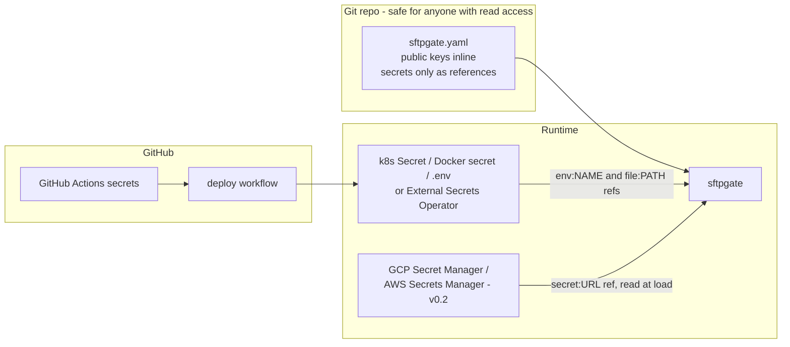

| Field | Secret? | Allowed form |
|---|---|---|
| `auth.public_keys` | No. Public keys are meant to be shared. | Inline or reference |
| `auth.password_hash` | Yes. A bcrypt hash can still be cracked offline if leaked. | Reference only |
| `server.host_keys` | Yes | File path (mounted secret) |
| `jobs.list[].remote.private_key` | Yes | Reference only |
| `on_upload` PGP `key`, `passphrase`, webhook `secret` | Yes | Reference only |
| `http.tokens` | Yes | Reference only |

**GitHub secrets, an important detail:** GitHub Actions secrets can only be read *inside a workflow run*. A running container can't fetch them later. So the supported pattern is that the deploy workflow hands them to the runtime:

```yaml
# .github/workflows/deploy.yml (org's repo), Kubernetes example
- run: |
    kubectl create secret generic sftpgate-secrets \
      --from-literal=RAZORPAY_PW_HASH='${{ secrets.RAZORPAY_PW_HASH }}' \
      --from-literal=SFTPGATE_UI_TOKEN='${{ secrets.SFTPGATE_UI_TOKEN }}' \
      --dry-run=client -o yaml | kubectl apply -f -
# the sftpgate Deployment loads it with envFrom: secretRef: sftpgate-secrets
```

For Docker Compose on a VM, the workflow writes the same values to a root-only `.env` file over SSH. SFTPgate itself needs **zero GitHub-specific code**. It only reads env vars and files, which every secret system can produce.

## 7. Observability

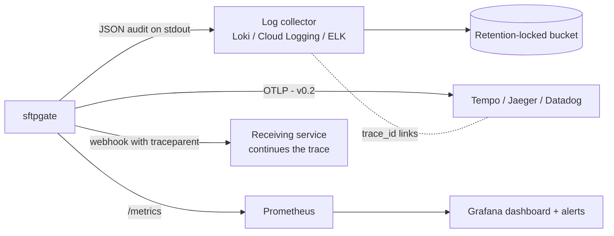

- **Metrics:** connections, auth results, active sessions, transfers (count, bytes, duration) by account, folder and direction, action results and queue depth, config reloads and config info, throttled IPs, storage errors. Full list in the LLD.
- **Traces (v0.2, optional):** OpenTelemetry over OTLP, enabled only when the standard `OTEL_EXPORTER_OTLP_ENDPOINT` env var is set (no YAML). Session → file operation → storage call / action step. Webhooks carry `traceparent`, so the receiving service continues the same trace. Audit records include `trace_id` to link logs and traces.
- **Dashboard (v0.2):** traffic per partner, auth failures, error rates, action backlog, config version timeline.
- **Suggested alerts:** auth-failure spike, storage errors > 0, action failures > 0, readiness down, config reload error.

## 8. Testing strategy

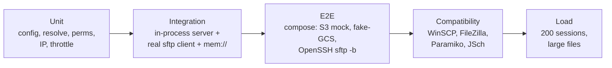

| Level | What | How |
|---|---|---|
| Unit | Config validation, path resolution, permissions, IP matching, throttle, templates | `go test`, table-driven. |
| Integration | Full server in-process over loopback, with a real `pkg/sftp` client against `mem://` blob: auth modes, perms, upload/download/rename/list/limits, reload behaviour | `go test`, no Docker needed. |
| E2E | Compose stack with an S3 mock + fake-GCS. OpenSSH `sftp -b` batch scripts | `make e2e` in CI. |
| Compatibility | WinSCP, FileZilla, Paramiko, JSch, Cyberduck | Manual checklist per release. |
| Load | 200 concurrent sessions, large files | Simple Go load script, run before each release. |

## 9. Risks

| Risk | Mitigation |
|---|---|
| Spool disk fills with large concurrent uploads | Size limits per folder. Document spool sizing. Expose a free-space metric. Refuse new uploads below a free-space threshold. |
| Clients that expect POSIX semantics (append, resume, atomic rename) | Fail clearly with SFTP error codes. Document limitations. Test the major clients. |
| Legacy vendor clients needing old algorithms | Not supported, by decision: SHA-1 algorithms are never enabled. Vendors must upgrade their client (OpenSSH 7.2+, JSch 0.1.54+ forks such as mwiede/jsch, Paramiko 2.9+). |
| `PartialSuccessError` requires a recent `x/crypto` | Pin a version that has it. Covered by an integration test. |
