# SFTPgate — Low-Level Design

Status: Draft for review · Implements [HLD](HLD.md) · Requirements in [PRD](PRD.md)

Sections are tagged **[v0.1]**, **[v0.2]** or **[v0.3]**. Anything untagged is v0.1.

---

## 1. Repository layout

```
sftpgate/
├── cmd/sftpgate/main.go          # CLI: serve | validate | hash-password | version
├── internal/
│   ├── config/                   # types, load, interpolate, defaults, validate, watch
│   ├── server/                   # TCP listener, IP filter, throttle, SSH auth, sessions
│   ├── vfs/                      # pkg/sftp handlers: resolve, perms, read, write, cmds, list
│   ├── storage/                  # named bucket registry over gocloud blob
│   ├── audit/                    # Event type + Emit (slog JSON)
│   ├── metrics/                  # Prometheus collectors
│   ├── actions/                  # [v0.2] durable queue, workers, steps
│   ├── jobs/                     # [v0.3] cron pull/push
│   └── web/                      # HTTP: metrics, health; [v0.3] api + ui (embed)
├── deploy/compose/               # docker-compose.yml, prometheus.yml, grafana/
├── examples/sftpgate.yaml        # annotated full example
├── schema/sftpgate.schema.json   # JSON Schema for editor validation
├── test/                         # all tests live here, apart from the code
│   ├── config/  vfs/  server/    # package tests, using each package's public API
│   ├── integration/              # real server on localhost + real SSH/SFTP clients
│   └── e2e/                      # sftp batch checks against docker compose (`make e2e`)
├── docs/                         # PRD, HLD, LLD
├── Dockerfile
├── Makefile                      # build, test, lint, e2e, dev-keys
└── go.mod
```

Package dependencies (arrows point at what a package imports):

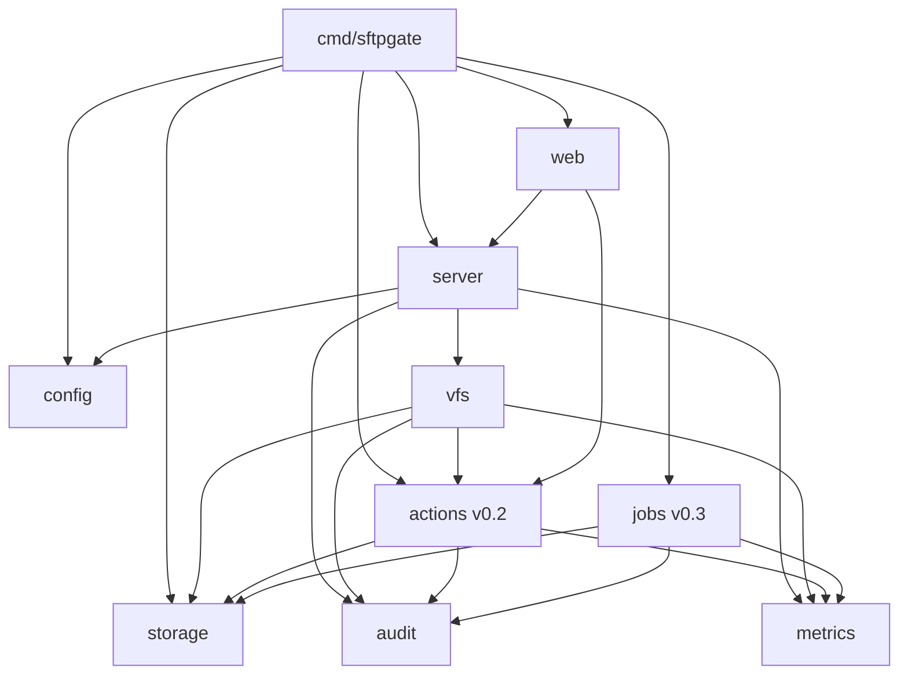

`config` and `audit` import nothing internal. `metrics` imports only `config` (to create every series at zero, see 8). There are no import cycles.

Line budget (non-test Go, v0.1): config ~600, server ~500, vfs ~700, storage ~80, audit ~60, metrics ~80, web ~80, main ~120. **Total ≈ 2,200.**

## 2. Dependencies

| Module | Purpose | Why not stdlib |
|---|---|---|
| `golang.org/x/crypto/ssh` | SSH server, `PartialSuccessError` for 2FA | No stdlib SSH. Pin a version with `PartialSuccessError` (added late 2024). |
| `golang.org/x/crypto/bcrypt` | Password hashes | — |
| `golang.org/x/term` | No-echo password prompt in `hash-password` | — |
| `github.com/pkg/sftp` | SFTP protocol + `RequestServer` | — |
| `gocloud.dev/blob` (+ `gcsblob`, `s3blob`, `azureblob`, `fileblob`, `memblob`) | Storage abstraction | — |
| `gopkg.in/yaml.v3` | YAML with strict field checking | — |
| `github.com/prometheus/client_golang` | Metrics | — |
| `github.com/ProtonMail/go-crypto` **[v0.2]** | OpenPGP | `x/crypto/openpgp` is deprecated. |
| `github.com/robfig/cron/v3` **[v0.3]** | Cron parsing | — |
| `go.opentelemetry.io/otel` + `otlptracehttp` exporter **[v0.2]** | Traces | — |
| `gocloud.dev/runtimevar` (`gcpsecretmanager`, `awssecretsmanager`, `awsparamstore`) **[v0.2]** | `${secret:}` refs | Same gocloud family already used for blob, so one URL style. |

No CLI framework (stdlib `flag`), no logging library (`log/slog`), no web framework (`net/http` with Go 1.22+ routing patterns), no JS.

---

## 3. Configuration

### 3.1 Full schema (annotated)

> **As built in v0.4: actions and hooks.** The `on_upload` design below was
> generalized. Actions are defined once under a top-level `actions:` map
> (`check`, `pgp_decrypt`, `pgp_encrypt`, `copy`, `webhook`) and listed by name
> in `hooks:` on folders (`before_upload`, `after_upload`, `after_download`)
> and transfers (`before_push`/`after_push`, `before_pull`/`after_pull`). The
> queue settings moved from `actions:` to `server.queue:`. `on_upload` still
> works as another way to write `hooks.after_upload`. "Before" hooks run
> synchronously through `actions.Runner.Before` (checks, plus `pgp_encrypt`
> before a push); "after" hooks queue a job carrying its hook and, for
> transfers, the transfer name. Reference: `docs/ONBOARDING.md` 8.7 and
> `examples/sftpgate.full.yaml`.

```yaml
version: 1                                   # required, must be 1

server:
  listen: ":2222"                            # default ":2222"
  host_keys:                                 # required, ≥1 PEM/OpenSSH private key files
    - /etc/sftpgate/keys/ssh_host_ed25519_key
  allow_ips: []                              # global CIDR/IP allowlist; empty = allow any
  banner: ""                                 # optional pre-auth banner
  idle_timeout: 15m                          # close idle sessions; default 15m
  max_auth_tries: 6                          # per connection; default 6 (same as OpenSSH)
  max_connections: 25                        # all accounts together; default 25
  spool_dir: /var/lib/sftpgate/spool         # default
  min_spool_free: 1GiB                       # refuse uploads below this; default 1GiB
  timezone: UTC                              # for {date} templates & schedules; default UTC
  reload_interval: 10s                       # config file poll; default 10s
  throttle:                                  # per-IP failed auth
    max_failures: 5                          # default 5
    window: 10m                              # default 10m
    block: 15m                               # default 15m

http:
  listen: ":8080"                            # metrics, health, api
  tokens: ["${env:SFTPGATE_API_TOKEN}"]       # read-only api; off when empty
  admin:                                     # [v0.4] off unless both set
    tokens: ["${env:SFTPGATE_ADMIN_TOKEN}"]  # must differ from tokens
    allow: [run_transfer, retry_actions]

storages:                                    # name -> gocloud blob URL
  recon-raw: "gs://acme-recon-raw"
  reports:   "s3://acme-reports?region=ap-south-1"
  dev:       "s3://dev?endpoint=http://s3:9090&use_path_style=true&region=us-east-1"   # any S3-compatible store
  local:     "file:///data"

accounts:
  - name: razorpay                           # = SSH username; [a-z0-9][a-z0-9._-]{0,63}
    description: Settlement reconciliation   # free text, shown by the api
    auth:
      mode: all                              # any | all ; default any
      public_keys:                           # authorized_keys format lines
        - "ssh-ed25519 AAAAC3Nza... razorpay-prod"
      password_hash: "${env:RAZORPAY_PW_HASH}"   # bcrypt; from `sftpgate hash-password`
    allow_ips: ["52.66.0.0/16", "13.232.10.4"]   # empty = only global rule applies
    max_sessions: 5                          # 0 = unlimited; default 0
    folders:
      - path: /inbound                       # single segment, unique per account
        storage: recon-raw                   # must exist in storages
        prefix: razorpay/                    # object key prefix; normalized to end with "/"
        perms: [list, upload]
        patterns: ["*.csv", "*.csv.pgp"]     # base-name globs (path.Match); empty = any
        max_file_size: 500MiB                # B, KiB, MiB, GiB; 0 = unlimited
        on_upload:                           # [v0.2] ordered steps
          - pgp_decrypt: { key: "${file:/secrets/recon-private.asc}", passphrase: "${env:RECON_PGP_PASS}" }
          - copy: { storage: reports, key: "warehouse/{account}/{date}/{filename}" }
          - webhook: { url: "https://hooks.acme.in/recon", secret: "${env:RECON_HOOK_SECRET}" }
      - path: /outbound
        storage: reports
        prefix: razorpay/
        perms: [list, download, delete]

actions:                                     # [v0.2]
  workers: 4                                 # default 4
  max_attempts: 8                            # default 8
  backoff: 30s                               # base; doubles per attempt, capped at 1h

jobs:                                        # [v0.3]
  enabled: true                              # set false on all but one replica
  list:
    - name: bank-statements-pull
      schedule: "0 6 * * *"
      direction: pull                        # pull: remote -> storage | push: storage -> remote
      remote:
        addr: sftp.bank.example:22
        user: acme
        private_key: "${file:/secrets/bank_id_ed25519}"
        host_key: "ssh-ed25519 AAAA..."      # pinned, required
        path: /out
        pattern: "*.csv"
      storage: recon-raw
      key: "bank/{date}/{filename}"
      after: keep                            # pull: keep | delete (remote file)
                                             # push: keep | delete | move:<prefix> (storage object)
```

### 3.2 Go types (abridged)

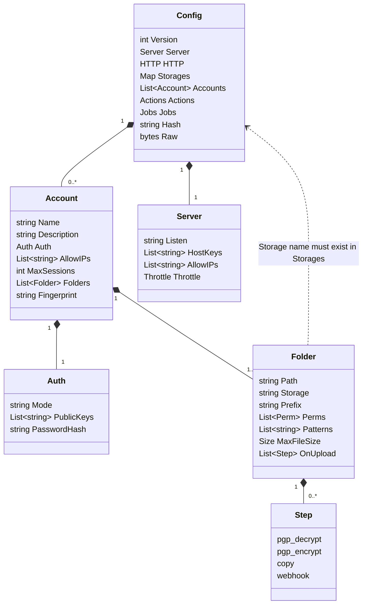

```go
package config

type Config struct {
    Version  int                `yaml:"version"`
    Server   Server             `yaml:"server"`
    HTTP     HTTP               `yaml:"http"`
    Storages map[string]string  `yaml:"storages"`
    Accounts []Account          `yaml:"accounts"`
    Actions  Actions            `yaml:"actions"`   // v0.2
    Jobs     Jobs               `yaml:"jobs"`      // v0.3

    // derived at load, not in YAML
    Hash     string                    `yaml:"-"` // sha256 of raw file bytes
    Raw      []byte                    `yaml:"-"` // pre-interpolation bytes, safe to display
    byName   map[string]*Account       `yaml:"-"`
    globalIP []netip.Prefix            `yaml:"-"`
}

type Account struct {
    Name        string   `yaml:"name"`
    Description string   `yaml:"description"`
    Auth        Auth     `yaml:"auth"`
    AllowIPs    []string `yaml:"allow_ips"`
    MaxSessions int      `yaml:"max_sessions"`
    Folders     []Folder `yaml:"folders"`

    keys        [][]byte       // ssh.PublicKey.Marshal() of each key
    ips         []netip.Prefix
    Fingerprint string         // sha256 of this account's normalized YAML + its storages' URLs
}

type Auth struct {
    Mode         string   `yaml:"mode"` // "any" | "all"
    PublicKeys   []string `yaml:"public_keys"`
    PasswordHash string   `yaml:"password_hash"`
}

type Folder struct {
    Path        string   `yaml:"path"`
    Storage     string   `yaml:"storage"`
    Prefix      string   `yaml:"prefix"`
    Perms       []Perm   `yaml:"perms"`
    Patterns    []string `yaml:"patterns"`
    MaxFileSize Size     `yaml:"max_file_size"`
    OnUpload    []Step   `yaml:"on_upload"` // v0.2

    perm PermSet // bitmask built at load
}

type Perm string // list|download|upload|overwrite|delete|rename|mkdir
type PermSet uint8
func (s PermSet) Has(p PermSet) bool { return s&p == p }

type Size int64 // UnmarshalYAML parses "500MiB"; plain integers are bytes
```

`time.Duration` fields decode from `"15m"` natively with yaml.v3.

### 3.3 Load pipeline

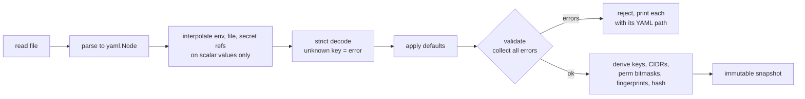

```
Load(path) (*Config, error):
  1. raw := os.ReadFile(path)
  2. var root yaml.Node; yaml.Unmarshal(raw, &root)
  3. interpolate(&root): walk scalar nodes; replace each ${env:NAME} / ${file:PATH}
        - env missing        -> error "accounts[0].auth.password_hash: env RAZORPAY_PW_HASH not set"
        - file: content with trailing newline trimmed
        - [v0.2] ${secret:URL}: runtimevar.OpenVariable(URL) -> Latest(ctx), 10s timeout, string decoder
              e.g. ${secret:gcpsecretmanager://projects/acme/secrets/razorpay-pw-hash?decoder=string}
                   ${secret:awssecretsmanager://razorpay-pw-hash?region=ap-south-1&decoder=string}
              re-read on every reload, so rotating a secret takes effect on the next reload (SIGHUP)
        - records the YAML path of every scalar that was a reference (refs set), used by validate
        - interpolation happens on parsed scalars, so values can never inject YAML structure
  4. b := yaml.Marshal(&root); dec := yaml.NewDecoder(b); dec.KnownFields(true); dec.Decode(&cfg)
        - unknown keys are errors (catches typos like "perm:")
  5. applyDefaults(&cfg)
  6. validate(&cfg) -> collects ALL errors (errors.Join), each prefixed with a YAML path
  7. derive: byName, parsed prefixes, marshaled keys, PermSets, fingerprints, Hash, Raw
```

### 3.4 Validation rules

| Field | Rule |
|---|---|
| `version` | == 1 |
| `server.host_keys` | ≥1, each file parses with `ssh.ParsePrivateKey` (serve only, not `validate --offline`) |
| `*.allow_ips` | each parses as `netip.ParsePrefix`, or as `netip.ParseAddr` (→ /32 or /128) |
| `storages` | name `[a-z0-9-]+`. URL scheme in {gs, s3, azblob, file, mem} |
| `accounts[].name` | regex above, unique |
| `auth.mode` | any \| all. `all` requires ≥1 key **and** a password_hash. `any` requires ≥1 of them |
| `auth.public_keys` | each parses with `ssh.ParseAuthorizedKey`. No `ssh-dss` |
| `auth.password_hash` | must be a reference (see secret fields). The resolved value must start with `$2a$`/`$2b$`/`$2y$` with cost ≥ 10. Anything else is rejected as a "possible plaintext password" |
| **secret fields** | `auth.password_hash`, `jobs.list[].remote.private_key`, `pgp_decrypt.key`, `pgp_decrypt.passphrase`, `webhook.secret`, `http.tokens[]`: each YAML path must be in the refs set, otherwise the error is "inline secret not allowed, use ${env:}, ${file:} or ${secret:}" |
| `folders[].path` | `^/[a-zA-Z0-9._-]+$`, unique per account |
| `folders[].storage` | exists in `storages` |
| `folders[].prefix` | no leading `/`, no `..` segments. Normalized to `""` or `x/` |
| `folders[].perms` | ≥1, known values. `overwrite`, `rename` imply nothing else (explicit only) |
| `folders[].patterns` | `path.Match(p, "x")` returns no `ErrBadPattern` |
| `on_upload[]` [v0.2] | exactly one step key per item. Referenced storages exist. Templates use only known vars |
| `jobs.list[]` [v0.3] | cron parses. `host_key` parses. Names unique |

`sftpgate validate --offline` skips checks that need files or the network (host key files, `${file:}` and `${secret:}` refs, storage reachability). The inline-secret rule **still applies offline**, since it is a check on the YAML text and catches the leak in the PR before merge. This is for CI runs that don't have prod secrets: `${env:}` / `${file:}` are then replaced by placeholders and only their syntax is checked.

### 3.5 Holder and reload

```go
type Holder struct {
    cur  atomic.Pointer[Config]
    path string
    onSwap func(old, new *Config) // server: kick changed sessions; storage: reopen
}

func (h *Holder) Get() *Config
func (h *Holder) Run(ctx context.Context)  // ticker(reload_interval) + SIGHUP
func (h *Holder) reload() error            // read; if sha256 == cur.Hash -> return; Load; storage.Prepare(new); swap; onSwap
```

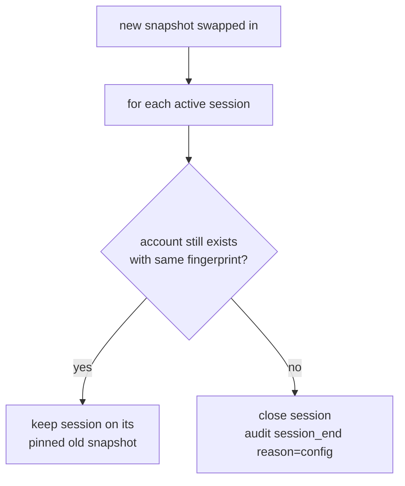

- Each session **pins the snapshot it authenticated with**. On swap, the server closes every session whose `account.Fingerprint` differs from the new config's version of that account, or whose account is gone. Unaffected sessions continue untouched.
- `reload_interval`, `server.listen`, `server.host_keys`, `http.listen` and `spool_dir` are **not hot-reloadable**. If they change, the reload is accepted for everything else, and a warning is logged and audited ("restart required for server.listen").

---

## 4. Server

### 4.1 Listener

```go
func (s *Server) Serve(ctx context.Context, ln net.Listener) error {
    for {
        c, err := ln.Accept()
        // ...
        ip := remoteIP(c) // netip.Addr from *net.TCPAddr, Unmap()'d
        cfg := s.cfg.Get()
        if !allowed(cfg.globalIP, ip) || s.throttle.Blocked(ip) {
            audit(conn_rejected); metrics; c.Close(); continue
        }
        go s.handle(ctx, c, ip)
    }
}
```

`handle` sets a 30 s handshake deadline, runs `ssh.NewServerConn(c, s.sshConfig(ip))`, clears the deadline and serves channels. An idle timeout is enforced by wrapping `net.Conn` with a deadline extended on every Read/Write.

### 4.2 SSH config

```go
cfg := &ssh.ServerConfig{
    MaxAuthTries:              cfg.Server.MaxAuthTries,
    PublicKeyCallback:         a.publicKey,          // is this key allowed?
    VerifiedPublicKeyCallback: a.verifiedPublicKey,  // client proved it owns the key
    PasswordCallback:          a.password,
    AuthLogCallback:           a.logAttempt,         // remembers the username for audit
    BannerCallback:            banner,
    ServerVersion:             "SSH-2.0-SFTPgate",
}
for _, k := range hostKeys { cfg.AddHostKey(k) }
// SHA-1 is never offered, and there is no switch to turn it on (PRD open question 4).
// The x/crypto defaults still include diffie-hellman-group14-sha1, hmac-sha1 and
// ssh-rsa, so KeyExchanges, MACs and PublicKeyAuthAlgorithms are set explicitly,
// and RSA host keys are wrapped to sign with rsa-sha2-256/512 only.
```

### 4.3 Authentication

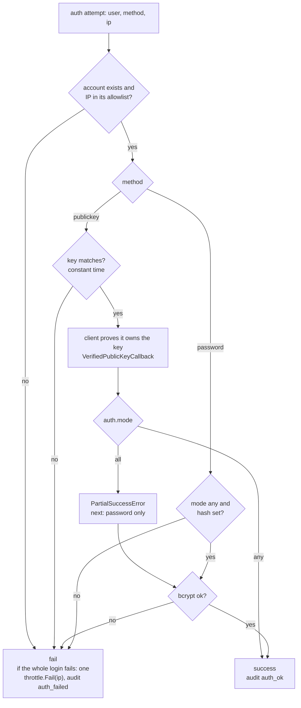

Unknown users and the "no" branches still run bcrypt against a dummy hash, so response timing doesn't reveal which accounts exist.

```go
// Is this key allowed? Called before the client proves it owns the key.
func (a *authenticator) publicKey(meta ssh.ConnMetadata, key ssh.PublicKey) (*ssh.Permissions, error) {
    acc := a.account(meta.User())          // account exists AND ip allowed
    if acc == nil || !hasKey(acc, key.Marshal()) { return nil, errAuth }
    return &ssh.Permissions{Extensions: {"account", "method": "publickey", "key_fp"}}, nil
}

// Called once the client proved it owns the key.
func (a *authenticator) verifiedPublicKey(_, _, perms *ssh.Permissions, _ string) (*ssh.Permissions, error) {
    acc := a.cfg.Account(perms.Extensions["account"])
    if acc.Auth.Mode != "all" { return perms, nil }
    return nil, &ssh.PartialSuccessError{Next: ssh.ServerAuthCallbacks{
        PasswordCallback: secondStep(acc), // only a password is allowed next
    }}
}

func (a *authenticator) password(meta ssh.ConnMetadata, pw []byte) (*ssh.Permissions, error) {
    acc := a.account(meta.User())
    usable := acc != nil && acc.Auth.Mode == "any" && acc.Auth.PasswordHash != ""
    hash := dummyHash                      // same work for unknown users
    if usable { hash = acc.Auth.PasswordHash }
    err := bcrypt.CompareHashAndPassword(hash, pw)
    if !usable || err != nil { return nil, errAuth }
    return &ssh.Permissions{Extensions: {"account", "method": "password"}}, nil
}
```

- **Verified in v0.1:** in `x/crypto` v0.58, `PublicKeyCallback` may **not** return `PartialSuccessError`. The second step has to be requested from `VerifiedPublicKeyCallback`, which runs only after the client has proven it owns the key. An integration test covers key+password, key only and password only.
- `hasKey` uses `subtle.ConstantTimeCompare` across all keys (no early exit).
- **Throttle and audit count one failure per failed connection, not per attempt.** OpenSSH clients normally offer several keys, and counting each one would block honest users. The failure is detected when `ssh.NewServerConn` returns a `*ssh.ServerAuthError`. `AuthLogCallback` keeps the last username tried (cut to 64 characters) for the audit line.
- In mode `all`, a password-first attempt is rejected (the password callback for `all` accounts always fails). Clients try publickey first by default.
- `max_auth_tries` defaults to 6, the same as OpenSSH, so clients with several keys in their agent can still log in.

### 4.4 Throttle

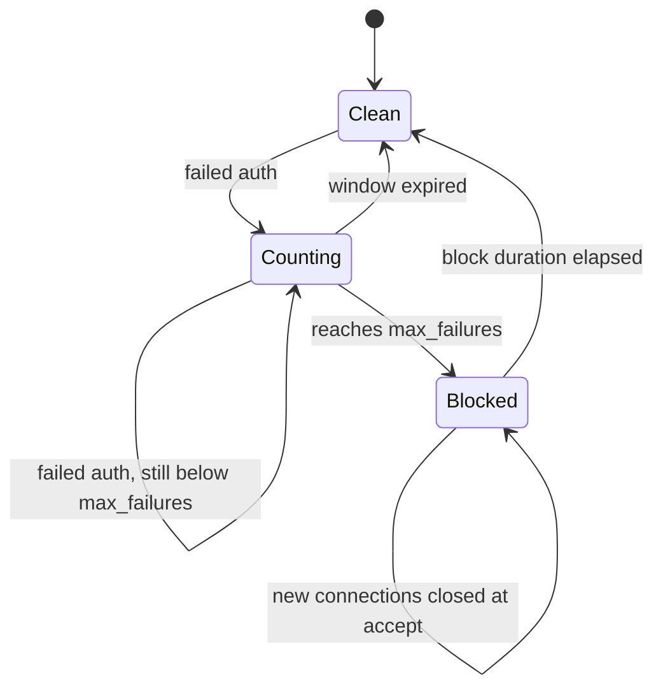

```go
type Throttle struct {
    mu sync.Mutex
    m  map[netip.Addr]*entry // {fails int, first time.Time, blockedUntil time.Time}
}
func (t *Throttle) Fail(ip netip.Addr)      // window reset if now-first > window; block at max_failures
func (t *Throttle) Blocked(ip netip.Addr) bool
func (t *Throttle) sweep()                  // every minute, drop expired entries (bounds memory)
```

Successful auth does **not** reset the counter (so attackers can't interleave one good login). Throttle settings are read from the current snapshot on every call.

### 4.5 Channels and session

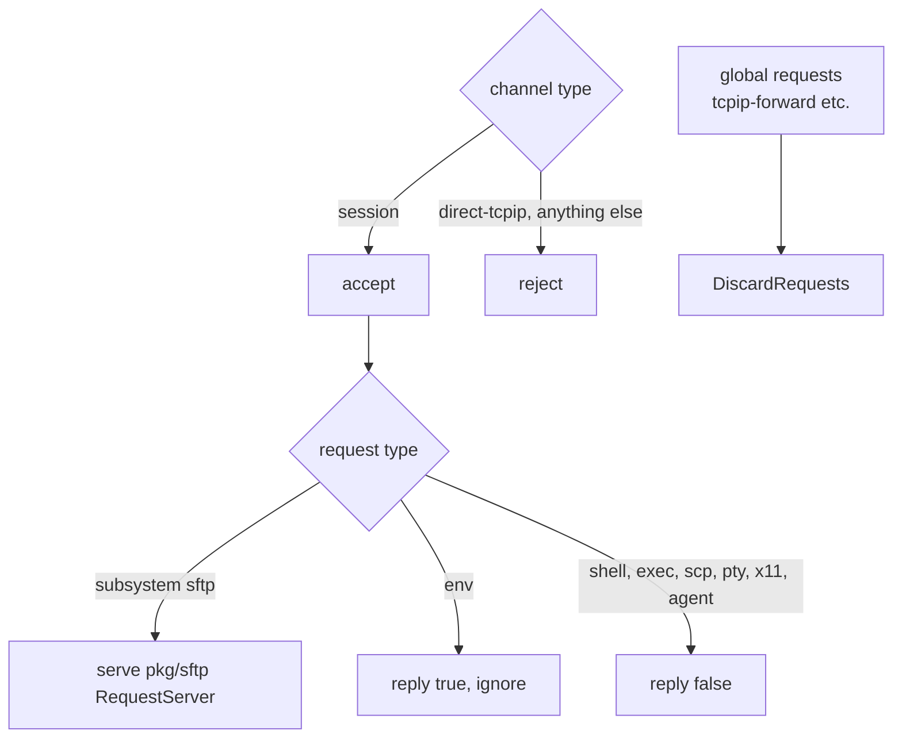

Session lifecycle:

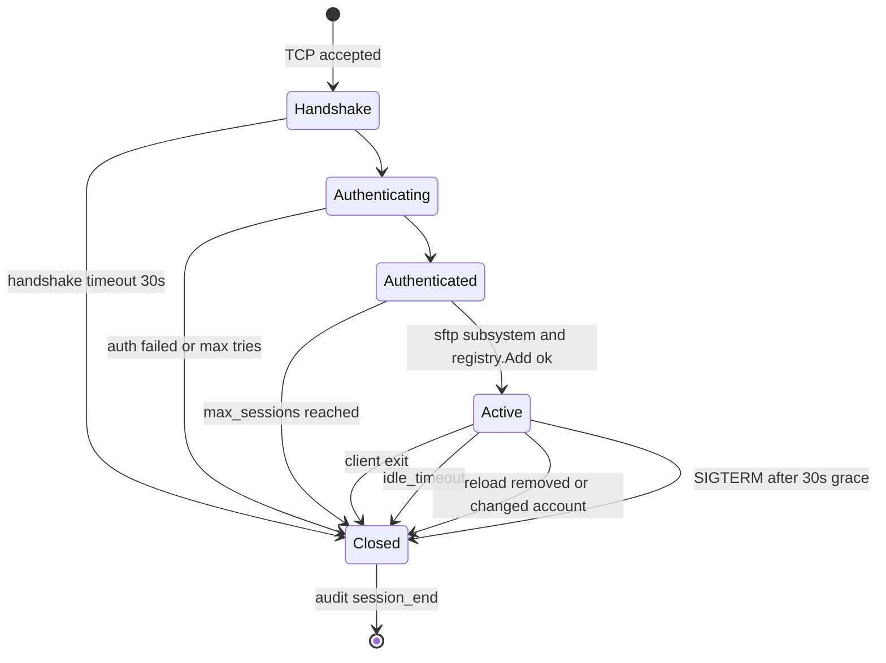

```go
for nc := range chans {
    if nc.ChannelType() != "session" { nc.Reject(ssh.UnknownChannelType, "only session"); continue }
    ch, reqs, _ := nc.Accept()
    go func() {
        for r := range reqs {
            switch {
            case r.Type == "subsystem" && subsystemName(r.Payload) == "sftp":
                r.Reply(true, nil); s.serveSFTP(ch, sess)
            case r.Type == "env":
                r.Reply(true, nil) // accepted & ignored; some clients send LANG
            default:
                r.Reply(false, nil) // shell, exec (incl. scp), pty-req, x11, agent
            }
        }
    }()
}
go ssh.DiscardRequests(globalReqs) // rejects tcpip-forward etc.
```

At most one SFTP subsystem is allowed per channel. The session is registered when the subsystem starts.

```go
type Session struct {
    ID        string       // 16 random bytes hex
    Account   *config.Account
    Cfg       *config.Config // pinned snapshot
    IP        netip.Addr
    Started   time.Time
    BytesIn, BytesOut atomic.Int64
    conn      *ssh.ServerConn // for Close() on reload
}

type Registry struct { mu sync.Mutex; byID map[string]*Session }
func (r *Registry) Add(s *Session) error   // enforces account.MaxSessions
func (r *Registry) Remove(id string)
func (r *Registry) CloseWhere(pred func(*Session) bool)
func (r *Registry) Snapshot() []SessionInfo // for metrics/API
```

---

## 5. VFS (pkg/sftp handlers)

```go
func Handlers(s *server.Session, st *storage.Registry, q actions.Enqueuer) sftp.Handlers {
    h := &handler{sess: s, st: st, q: q}
    return sftp.Handlers{FileGet: h, FilePut: h, FileCmd: h, FileList: h}
}
```

### 5.1 Path resolution

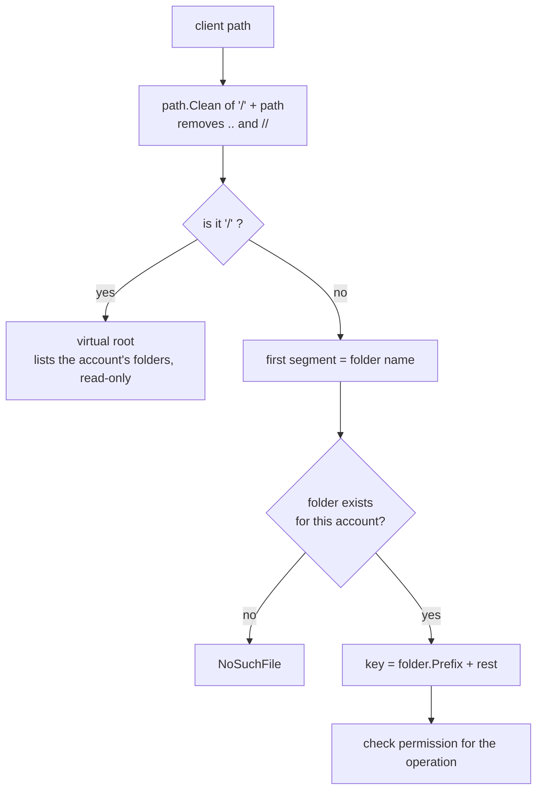

```go
type target struct {
    folder *config.Folder // nil => virtual root
    rel    string         // path inside folder, "" = folder itself
    key    string         // folder.Prefix + rel
}

func (h *handler) resolve(p string) (target, error) {
    p = path.Clean("/" + p)                 // removes .., //, trailing /
    if p == "/" { return target{}, nil }
    seg, rest, _ := strings.Cut(p[1:], "/")
    f := h.sess.Account.Folder("/" + seg)   // map lookup
    if f == nil { return target{}, sftp.ErrSSHFxNoSuchFile }
    return target{folder: f, rel: rest, key: f.Prefix + rest}, nil
}
```

Since `path.Clean` runs on an absolute path, `..` can never climb above `/`. Keys are built only from config prefix + cleaned rel. **Unit-tested with a fuzz test**, which asserts that every resolved key starts with `f.Prefix`.

### 5.2 Operation → permission map

| SFTP method | Requires | Notes |
|---|---|---|
| `List`, `Stat`, `Lstat` | `list` | Root `/` lists the account's folders (always allowed if the account has any folder). |
| `Get` (open read) | `download` | |
| `Put` / `Open` (write) | `upload`, plus `overwrite` if the object exists | `APPEND` flag is unsupported. `patterns` and `min_spool_free` are checked at open. |
| `Remove` | `delete` | Files only. |
| `Rmdir` | `delete` | Only empty dirs. |
| `Mkdir` | `mkdir` | |
| `Rename`, `PosixRename` | `rename`, plus `overwrite` if the target exists | Same folder only, files only. The target must match `patterns`. |
| `Setstat` | — | Returns OK and does nothing (WinSCP/FileZilla set mtime after upload). |
| `Symlink`, `Link`, `Readlink` | — | `ErrSSHFxOpUnsupported` |

Any operation on the root (`/`) other than list/stat returns `PermissionDenied`.

### 5.3 Write path (upload)

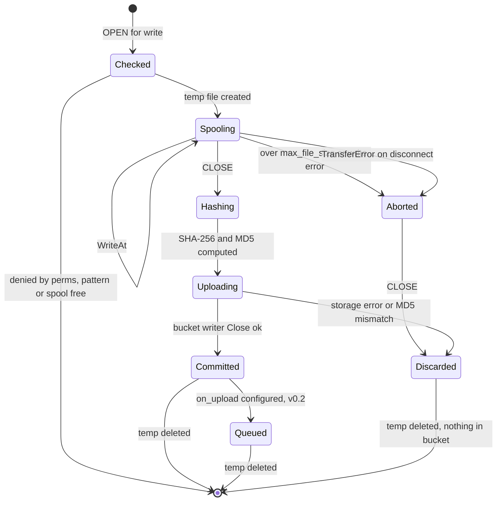

```go
func (h *handler) Filewrite(r *sftp.Request) (io.WriterAt, error) {
    t := resolve(r.Filepath); f := t.folder
    if f == nil || t.rel == "" { return nil, ErrPerm }
    if r.Pflags().Append { return nil, sftp.ErrSSHFxOpUnsupported }
    need(f, PermUpload)
    if exists(t.key) { need(f, PermOverwrite) }
    matchPatterns(f, path.Base(t.rel))
    checkSpoolFree()
    tmp := os.CreateTemp(spoolDir, "up-*")
    return &upload{h: h, t: t, f: tmp, max: f.MaxFileSize, start: time.Now()}, nil
}

type upload struct {
    mu      sync.Mutex
    f       *os.File
    size    int64  // high-water mark
    max     Size
    aborted error  // set by TransferError
    // ...
}

func (u *upload) WriteAt(p []byte, off int64) (int, error) {
    u.mu.Lock(); defer u.mu.Unlock()
    if u.max > 0 && off+int64(len(p)) > int64(u.max) {
        u.aborted = errTooLarge  // a later CLOSE must not commit the truncated file
        return 0, errTooLarge    // -> SSH_FX_FAILURE "file too large"
    }
    n, err := u.f.WriteAt(p, off)
    if err != nil { u.aborted = err }
    u.size = max(u.size, off+int64(n))
    return n, err
}

// pkg/sftp calls TransferError when the session dies with the handle open.
func (u *upload) TransferError(err error) { u.aborted = err }

func (u *upload) Close() error {
    defer os.Remove(u.f.Name()); defer u.f.Close()
    if u.aborted != nil { audit(upload, failed, "aborted"); return nil } // never commit partial
    sha, md5 := hashFile(u.f)                 // pass 1: local disk
    w := bucket.NewWriter(ctx, u.t.key, &blob.WriterOptions{
        ContentMD5: md5,                      // backend verifies integrity
        Metadata: {"sftpgate-account", "sftpgate-ip", "sftpgate-session", "sftpgate-sha256"},
    })
    io.Copy(w, io.NewSectionReader(u.f, 0, u.size))   // pass 2: upload
    if err := w.Close(); err != nil { audit(failed); return mapErr(err) } // object not created
    audit(upload ok, size, sha); metrics; h.q.Enqueue(job)  // v0.2
    return nil
}
```

- **Atomicity:** GCS/S3/Azure only make an object visible on a successful `w.Close()`. An abort or error leaves nothing behind.
- **Concurrent uploads to the same key:** last successful close wins (documented).
- **Spool** is created with mode 0600 in a directory with mode 0700. On startup, `up-*` files left over from a crash are deleted.
- **Verified in v0.1:** `pkg/sftp` calls `TransferError` on every handle still open when `Serve` exits, before `Close`. A test cuts the connection mid-upload and checks that nothing reaches the bucket. Any `WriteAt` error (including "too large") also marks the upload as failed, so a later `CLOSE` can't commit a cut-off file.

### 5.4 Read path (download)

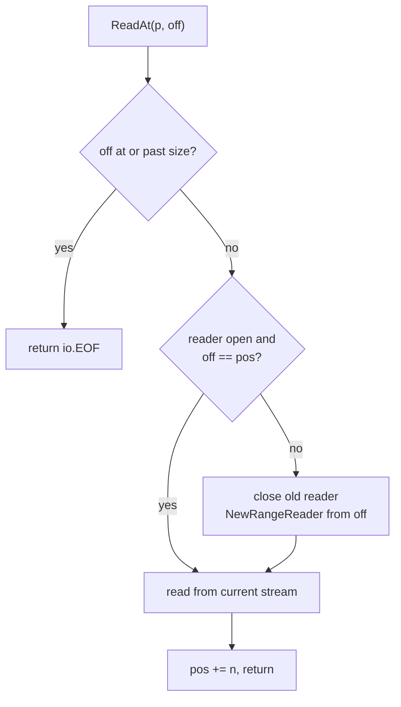

```go
type download struct {
    mu  sync.Mutex
    b   *blob.Bucket; key string; size int64
    r   *blob.Reader; pos int64
}

func (d *download) ReadAt(p []byte, off int64) (int, error) {
    d.mu.Lock(); defer d.mu.Unlock()
    if off >= d.size { return 0, io.EOF }
    if d.r == nil || off != d.pos {            // sequential reuse, reopen on seek
        if d.r != nil { d.r.Close() }
        d.r = d.b.NewRangeReader(ctx, d.key, off, -1, nil); d.pos = off
    }
    n, err := io.ReadFull(d.r, p); d.pos += int64(n)
    if err == io.ErrUnexpectedEOF { err = io.EOF }
    return n, err
}
```

- **Performance risk:** if `pkg/sftp` serves pipelined reads for one handle out of order, reopens increase. The v0.1 load test measures reopen count. Fallback if needed: keep a small map of readers keyed by next offset (≤4), or spool-on-read. Decided by measurement, not up front.
- Close emits audit `download` with the bytes actually served.

### 5.5 Commands

Rename (the only multi-step command):

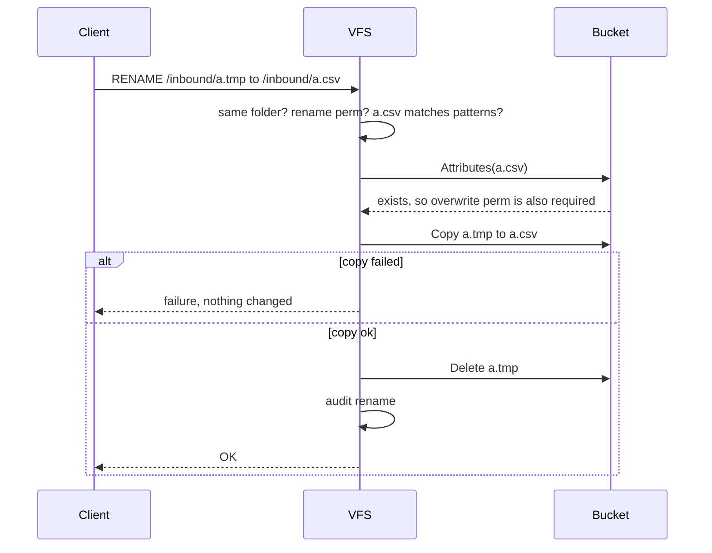

```go
func (h *handler) Filecmd(r *sftp.Request) error {
    switch r.Method {
    case "Setstat":            return nil
    case "Remove":             // need delete; b.Delete(key); audit
    case "Mkdir":              // need mkdir; write zero-byte key+"/"; audit
    case "Rmdir":              // need delete; list key+"/" limit 2; only marker -> delete marker; else ErrFailure "not empty"
    case "Rename", "PosixRename":
        // src, dst resolve to SAME folder; need rename (+overwrite if dst exists); pattern(dst)
        // b.Copy(dst, src) then b.Delete(src). Copy failure -> nothing changed.
        // Delete failure after copy -> both exist; audit + error (rare, visible)
    case "Symlink", "Link":    return sftp.ErrSSHFxOpUnsupported
    }
}
```

### 5.6 Listing and stat

```go
func (h *handler) Filelist(r *sftp.Request) (sftp.ListerAt, error) {
    switch r.Method {
    case "List": // root -> folder dirs; else bucket.List(Prefix: dirPrefix(key), Delimiter: "/")
                 // skip the dir's own marker object; IsDir entries -> dir FileInfo (name without "/")
                 // materialize up to 10_000 entries; beyond that ErrFailure (documented limit)
    case "Stat", "Lstat":
        // rel=="" -> dir; Attributes(key) ok -> file; else list key+"/" limit 1 -> dir; else NoSuchFile
    case "Readlink": return nil, sftp.ErrSSHFxOpUnsupported
    }
}

type listerAt []os.FileInfo
func (l listerAt) ListAt(dst []os.FileInfo, off int64) (int, error) {
    if off >= int64(len(l)) { return 0, io.EOF }
    n := copy(dst, l[off:]); if n < len(dst) { return n, io.EOF }; return n, nil
}

type fileInfo struct{ name string; size int64; mod time.Time; dir bool }
// Mode(): dir -> fs.ModeDir|0o755 ; file -> 0o644 (cosmetic). Sys() -> nil
```

`shortcut: listing is materialized in memory, capped at 10k entries; switch to a streaming ListerAt if partners keep larger directories.`

### 5.7 Error mapping

```go
func mapErr(err error) error {
    switch {
    case errors.Is(err, errPerm):                   return sftp.ErrSSHFxPermissionDenied
    case gcerrors.Code(err) == gcerrors.NotFound:   return sftp.ErrSSHFxNoSuchFile
    case errors.Is(err, errTooLarge):               return sftp.ErrSSHFxFailure // message "file too large"
    default:
        slog.Error("storage", "err", err)           // full detail in logs only
        return sftp.ErrSSHFxFailure                  // never leak bucket names/internals to clients
    }
}
```

---

## 6. Storage registry

```go
type Registry struct {
    mu      sync.RWMutex
    byName  map[string]*entry // {url string, b *blob.Bucket}
}
func (r *Registry) Prepare(ctx context.Context, cfg *config.Config) error // open new/changed URLs; fail -> reload rejected
func (r *Registry) Bucket(name string) *blob.Bucket
func (r *Registry) Release(cfg *config.Config)   // close buckets no longer referenced (after swap)
func (r *Registry) Ping(ctx context.Context) map[string]error // readyz: List limit 1, cached 30s
```

Sessions pinned to an old snapshot may still reference a bucket that was released. To avoid this, `Release` is deferred until no session pins the old snapshot. `shortcut: simplest form: never close old buckets until restart (they are just HTTP clients); revisit only if reloads with changed URLs become frequent.`

---

## 7. Audit

### 7.1 Record format (one JSON line)

```json
{"time":"2026-10-24T06:01:02.345Z","level":"INFO","msg":"audit",
 "event":"upload","result":"ok","session":"9f2c…","account":"razorpay","ip":"52.66.1.9",
 "path":"/inbound/2026-10-24.csv","storage":"recon-raw","key":"razorpay/2026-10-24.csv",
 "size":1048576,"sha256":"ab12…","duration_ms":812,"config":"3be1…"}
```

| Field | Present on |
|---|---|
| `event` | always: `conn_rejected`, `auth_ok`, `auth_failed`, `session_start`, `session_end`, `upload`, `download`, `delete`, `rename`, `mkdir`, `rmdir`, `config_reload`, `action` (v0.2), `job_run` (v0.3) |
| `result` | always: `ok` \| `denied` \| `failed` |
| `error` | when result ≠ ok (sanitized message) |
| `session`, `account`, `ip` | when known |
| `method` | auth events: `publickey` \| `password` |
| `key_fp` | auth with a key: SHA256 fingerprint (which of the partner's keys was used) |
| `path`, `storage`, `key`, `to_path`, `to_key` | file events (`to_*` on rename) |
| `size`, `sha256`, `duration_ms` | upload/download |
| `config` | content hash of the config in effect |
| `trace_id` | [v0.2] when tracing is enabled |

`list`/`stat` are not audited (noisy, low value). They are counted in metrics.

### 7.2 API

```go
package audit
type Event struct { Name, Result, Err, Session, Account, IP, Method, KeyFP, Path, Storage, Key, ToPath, ToKey, SHA256, Config string; Size, DurationMS int64 }
func Emit(e Event)  // slog JSON to stdout (+ optional file); empty fields omitted; [v0.3] also pushes to ring buffer
```

Audit and operational logs share stdout. They are distinguished by `msg:"audit"` so collectors can route them.

---

## 8. Metrics

| Name | Type | Labels |
|---|---|---|
| `sftpgate_connections_total` | counter | `result` (accepted, rejected_ip, rejected_throttle) |
| `sftpgate_auth_total` | counter | `account` (`_unknown` for unknown users), `method`, `result` |
| `sftpgate_sessions_active` | gauge | `account` |
| `sftpgate_operations_total` | counter | `account`, `folder`, `op` (upload, download, delete, rename, mkdir, rmdir, list), `result` |
| `sftpgate_transfer_bytes_total` | counter | `account`, `folder`, `direction` (in, out) |
| `sftpgate_transfer_duration_seconds` | histogram | `direction` |
| `sftpgate_storage_errors_total` | counter | `storage` |
| `sftpgate_throttled_ips` | gauge | — |
| `sftpgate_spool_free_bytes` | gauge | — |
| `sftpgate_config_reload_total` | counter | `result` |
| `sftpgate_config_info` | gauge (=1) | `hash`, `revision` (from `SFTPGATE_REVISION` env, optional) |
| `sftpgate_actions_total` [v0.2] | counter | `step`, `result` |
| `sftpgate_actions_queue_depth` [v0.2] | gauge | `state` (pending, failed) |
| `sftpgate_jobs_total` [v0.3] | counter | `job`, `result` |

Cardinality is bounded: `account`, `folder`, `storage`, `step` and `job` all come from config. IPs and paths are never labels.

`metrics.Prepare(cfg)` runs at startup and after every reload. It creates every series the config can produce at 0. Without it, the first event of each counter is lost: `rate()` and `increase()` need an earlier sample, so a first storage error would never show on the dashboard or fire an alert.

---

## 8a. Traces [v0.2]

- **As built:** export is OTLP/**HTTP** (`otlptracehttp`), not gRPC, because it's simpler and passes through firewalls and proxies more easily. SFTPgate's spans go to their own tracer provider (`tracing.Use`). The **global** OpenTelemetry provider stays a no-op on purpose: gocloud creates its own spans for every bucket call, and their error messages contain object keys. A test checks that no span attribute holds a file name or key. The local setup includes Jaeger, and `make e2e` checks that traces arrive.
- **Enablement:** the standard OTel env vars only (`OTEL_EXPORTER_OTLP_ENDPOINT`, `OTEL_SERVICE_NAME`, `OTEL_TRACES_SAMPLER`…). If the endpoint is unset, a no-op tracer is used, at zero cost. No YAML keys.
- **Span tree:**

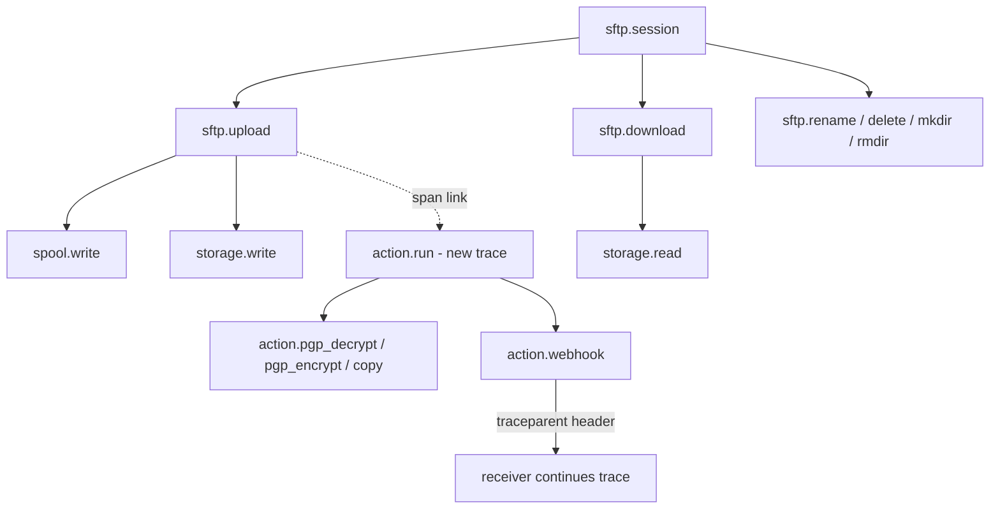

```
sftp.session                 account, ip, session_id, auth.method
├── sftp.upload              folder, size, result
│   ├── spool.write
│   └── storage.write        storage
├── sftp.download            folder, size, result
│   └── storage.read         storage
├── sftp.rename | delete | mkdir | rmdir
action.run                   job_id, account, folder, attempt   (linked to the upload span)
├── action.pgp_decrypt | pgp_encrypt | copy
└── action.webhook           http.status   (injects `traceparent` header)
```

- **Privacy:** spans carry account, folder, storage name, sizes and results. **Never** file names, object keys or file contents, because tracing backends are often less locked down than audit sinks. To find a specific file, join on `session_id`/`trace_id` with the audit log.
- `action.run` starts a new trace with a span **link** to the upload span (the job may run minutes later or after a restart). The upload span context is stored in the job file as `traceparent`.
- Code: one `tracing.Init(ctx) (shutdown func)` in `main`. Spans are opened in `server` (session) and `vfs`/`actions` (operations) with `otel.Tracer("sftpgate")`.

---

## 9. HTTP

```
GET /metrics            promhttp.Handler()                     no auth
GET /healthz            200 "ok" if process up                 no auth
GET /readyz             200 if config loaded && storages ping  no auth
GET /api/v1/...         [v0.3] see 11                          token
POST /api/v1/transfers/{name}/run   [v0.4] see 11             admin token, if allowed
POST /api/v1/actions/retry          [v0.4] see 11             admin token, if allowed
```

Read-only routes are `GET` only; other methods get 405 from the mux. The two `POST` routes are the only ones that change anything, and they answer 404 unless `http.admin.allow` lists them.

---

## 10. Actions [v0.2]

### 10.1 Job

```go
type Job struct {
    ID        string    `json:"id"`        // ulid-like: time + random
    Account   string    `json:"account"`
    Folder    string    `json:"folder"`
    Storage   string    `json:"storage"`
    Key       string    `json:"key"`
    Size      int64     `json:"size"`
    SHA256    string    `json:"sha256"`
    Uploaded  time.Time `json:"uploaded"`
    Attempt   int       `json:"attempt"`
    NextAt    time.Time `json:"next_at"`
    LastError string    `json:"last_error,omitempty"`
    TraceParent string  `json:"traceparent,omitempty"` // upload span, for linking
}
```

> **As built in v0.2.** The queue is at `<spool_dir>/queue`, and temp files are `<spool_dir>/work-*` (deleted on startup). One dispatcher scans the queue every second, and right away when a job is added, and hands due jobs to `actions.workers` goroutines. Before any step runs, the landing object is downloaded and its SHA-256 compared with the one recorded at upload. A mismatch means the file changed in the bucket, which is a permanent failure. Permanent failures (folder or storage removed from the config, changed file, undecryptable data) go to `failed/` at once instead of being retried. Webhook payloads also carry `copies`: the storage and key written by earlier `copy` steps. `server.timezone` (default UTC; tz data is embedded in the binary because the image has none) sets `{date}` and `{time}`. PGP signatures are verified when `pgp_decrypt.signer_keys` is set (v0.3+): an unsigned file, an unknown signer or a bad signature is a permanent failure, checked after the whole body is read and before anything is passed on. An enqueue failure after a successful upload is logged and counted (`sftpgate_actions_total{step="queue",result="failed"}`, alert `SftpgateActionsNotQueued`), and the client still gets OK, because its file is safe.

### 10.2 Durable queue

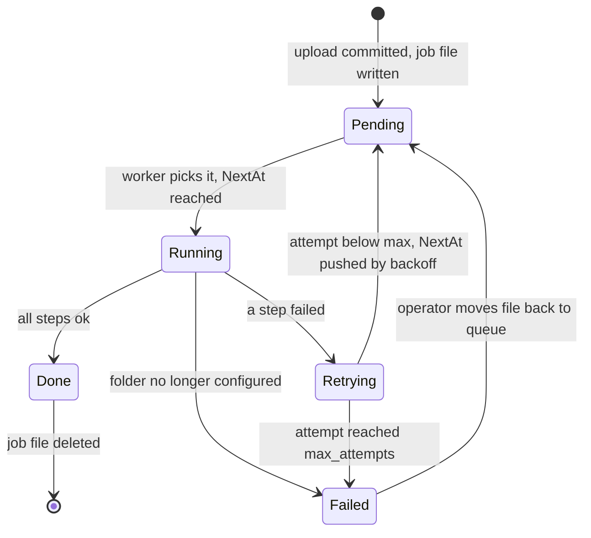

```
<spool_dir>/queue/<id>.json          pending (written via tmp + rename = atomic)
<spool_dir>/queue/failed/<id>.json   exhausted retries
```
- `Enqueue` writes the file, then signals the workers over a channel.
- Startup scans `queue/*.json` and schedules them by `NextAt`.
- A worker loads the job and resolves the folder's steps **from the current config** (the account or folder may have been removed, in which case the job moves to failed with "folder no longer configured"), then runs the pipeline.
- Success: delete the file. Failure: `Attempt++`, `NextAt = now + min(backoff·2^attempt, 1h)`, rewrite the file. If `Attempt == max_attempts`, move it to `failed/`.
- Operators re-drive failed jobs by moving files back to `queue/` (documented. No API, since the API is read-only).

### 10.3 Pipeline

Example: decrypt, copy, then notify.

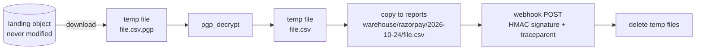

```go
type Step interface { Run(ctx context.Context, c *Current) error }

type Current struct {          // the "current file" flowing through steps
    Path     string            // local temp file (starts as a download of the landing object)
    Filename string            // base name; pgp_decrypt strips .pgp/.gpg/.asc
    Vars     map[string]string // account, folder, date, time, filename, job_id
}
```

| Step | Config | Behaviour |
|---|---|---|
| `pgp_decrypt` | `key`, `passphrase?` | Decrypt `Current` into a new temp file. Verification failure is an error. |
| `pgp_encrypt` | `recipients: [armored pubkeys]` | Encrypt `Current` into a new temp file. Appends `.pgp`. |
| `copy` | `storage`, `key` (template) | Upload `Current` to storage at the rendered key, with the same metadata + `sftpgate-job`. |
| `webhook` | `url`, `secret?`, `headers?` | POST JSON `{job_id, account, folder, storage, key, size, sha256, uploaded, filename}`. Header `X-Sftpgate-Signature: sha256=<hex HMAC of body>` if a secret is set. 10 s timeout. 2xx = ok. |

- The whole pipeline is retried from step 1 on failure. `copy` is idempotent (same key). `webhook` is **at-least-once**, so receivers dedupe by `job_id` (documented).
- Template vars: `{account} {folder} {date}` (YYYY-MM-DD in `server.timezone`) `{time}` (HHMMSS) `{filename} {job_id}`. Unknown vars are rejected at validate time.
- Temp files are removed after each run.

---

## 11. API and admin calls

> **As built.** Read-only routes exist only while `http.tokens` is set (otherwise 404). Tokens are secret references of at least 16 characters, compared in constant time on their SHA-256. API answers are `no-store`. The HTML UI of v0.3 was removed in v0.4; `/ui/` is a 404. `revision` comes from `SFTPGATE_REVISION`, or from the git-sync worktree folder name in the config's real path.


| Endpoint | Returns |
|---|---|
| `GET /api/v1/status` | version, uptime, config hash, revision, loaded_at, readiness per storage |
| `GET /api/v1/sessions` | active sessions: id, account, ip, started, bytes in/out |
| `GET /api/v1/events?event=&account=&limit=` | latest N audit events from the ring buffer (default 2,000 kept) |
| `GET /api/v1/actions` | pending + failed jobs (read from the queue dir) |
| `GET /api/v1/config` | `Raw` (pre-interpolation YAML, so secrets appear only as `${…}` references) |

- **Auth:** `Authorization: Bearer <token>` (or a Basic login with the token as password), compared in constant time against `http.tokens`.

**Admin calls [v0.4]** (`internal/web/admin.go`). Checked on every request against the live config, so a reload switches them on or off:

| Endpoint | Allow entry | Does | Answers |
|---|---|---|---|
| `POST /api/v1/transfers/{name}/run` | `run_transfer` | `Scheduler.Start`: claims the transfer and runs it in a goroutine with the server's ctx | 202; 404 `ErrNoTransfer`; 409 `ErrBusy`, or this replica doesn't run transfers |
| `POST /api/v1/actions/retry[?job=<id>]` | `retry_actions` | `Runner.Retry`: moves `failed/<id>.json` (or all) back to the queue with `attempt=0`, then wakes the dispatcher | 200 `{"retried": n}`; 404 `ErrNoJob` |

- Not listed in `allow` (or no admin tokens): 404, the route looks absent.
- Admin tokens: secret references, 16+ characters, never equal to a read-only token (checked by `validate`), Bearer header only, so a browser can't send them on its own.
- Every call, accepted or refused, emits an `admin` audit event with `method` (the operation), `ip`, and `transfer` or `job`.
- Failed jobs are per pod (on its spool disk), so retry acts on the pod reached.
- History beyond the ring buffer lives in the audit log pipeline (Loki/Cloud Logging). `shortcut: ring buffer is in-memory and per-replica; that's by design, since durable history is the log sink's job.`

---

## 12. Scheduled jobs [v0.3]

> **As built in v0.3.** The config uses top-level `remotes:` (name to addr, user, pinned `host_key`, `private_key` and/or `password`) and `transfers:` (each with `pull` or `push`). It does not use `jobs.list`. The name "jobs" was already taken by post-upload actions, and remotes are shared by several transfers. A YAML `enabled` flag can't differ between replicas that share one ConfigMap, so the scheduler is switched off per replica with `SFTPGATE_TRANSFERS=off`. Outgoing connections use the same no-SHA-1 algorithm lists as the server (`internal/sshalgo`). Push temp files are `.<name>` (dot-prefixed, same ending), so the partner's filename patterns still accept them. Each run closes both the SFTP client and the SSH connection under it: closing only the client leaks connections, a bug a test caught. The scheduler rebuilds its cron table whenever the config hash changes.


Pull job:

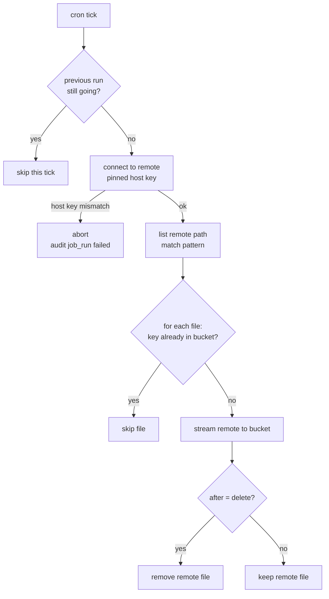

```go
// robfig/cron with time.LoadLocation(server.timezone); jobs.enabled=false -> scheduler not started
func runPull(ctx, j Job) error {
    c := sftpClient(j.Remote)                 // ssh.FixedHostKey(pinned) - never InsecureIgnoreHostKey
    for _, e := range c.ReadDir(j.Remote.Path) matching j.Remote.Pattern {
        key := render(j.Key, vars(e.Name()))
        if exists(storage, key) { continue }  // stateless dedupe
        stream remote -> blob writer; on success: audit(job_run file ok); if after==delete -> c.Remove
    }
}
func runPush(ctx, j Job) error {
    for obj in storage.List(prefix of j.Key template up to first var) matching pattern {
        stream blob -> remote tmp name ".<name>.part" -> c.PosixRename to final   // no partial files on their side
        after: keep (skip if remote exists) | delete | move:<prefix>
    }
}
```

A run that overlaps the previous one is skipped (`cron.SkipIfStillRunning`). Each run emits `job_run` audit + metrics.

---

## 13. CLI

```
sftpgate serve    [-config /etc/sftpgate/sftpgate.yaml]   # env SFTPGATE_CONFIG
sftpgate validate [-offline] <file>                       # exit 0 ok, 1 errors (all printed with YAML paths)
sftpgate hash-password [-cost 12]                         # prompts twice without echo, prints bcrypt hash
sftpgate version
```

Shutdown on SIGTERM: stop accepting, wait up to 30 s for in-flight uploads, then close sessions and exit. Uploads cut off by shutdown are aborted (never committed partially).

---

## 14. Packaging

### 14.1 Dockerfile
```dockerfile
FROM golang:1.25 AS build
WORKDIR /src
COPY go.mod go.sum ./
RUN go mod download
COPY . .
RUN CGO_ENABLED=0 go build -trimpath -ldflags="-s -w -X main.version=${VERSION}" -o /sftpgate ./cmd/sftpgate

FROM gcr.io/distroless/static-debian12:nonroot
COPY --from=build /sftpgate /sftpgate
EXPOSE 2222 8080
VOLUME /var/lib/sftpgate
ENTRYPOINT ["/sftpgate"]
CMD ["serve"]
```

### 14.2 Compose (dev/test)
- `sftpgate`: build `.`, ports `2222:2222`, `8080:8080`, mounts the **folder** `./config:/etc/sftpgate/config:ro` (not a single file: editors and git replace files, and a single-file bind mount keeps showing the old one, which silently breaks hot reload), `./.dev/keys:/etc/sftpgate/keys:ro`, volume `spool`, `read_only: true`.
- `s3` (`adobe/s3mock`, creates the bucket on start). MinIO no longer publishes the community images used for this.
- `fake-gcs` (`fsouza/fake-gcs-server`, **`-backend memory`**, because its disk backend drops `dir/` marker objects), with `STORAGE_EMULATOR_HOST` set for sftpgate.
- `prometheus`, `grafana` (provisioned datasource + `sftpgate.json` dashboard) **[v0.2]**.
- `git-sync` under the `gitops` profile, writing to a shared `/config` volume **[v0.3]**.
- `make dev-keys` runs `ssh-keygen -t ed25519` to generate the host key and a test user key into `.dev/` (gitignored).

---

## 15. Test plan

| Area | Tests |
|---|---|
| config | Every validation rule (table test: YAML snippet → expected error path). Interpolation of env/file/missing. Unknown field rejected. Size parser. Defaults. |
| resolve | Table tests + `FuzzResolve` (key always under prefix, never panics). |
| perms | Matrix: each op × each perm present/absent → allowed/denied. |
| ip/throttle | CIDR/IPv6/mapped-IPv4 matching. Throttle window/block/expiry with an injected clock. |
| integration (`mem://`) | auth any/all/key-only/password-only/wrong IP/unknown user. Upload → object + metadata + sha256. Upload over max size → nothing committed. Client killed mid-upload → nothing committed. Overwrite with/without perm. Download ranges. Rename same/cross folder. Mkdir/rmdir. Pattern rejection. Shell/exec rejected. max_sessions. Reload kicks changed account only. Invalid reload keeps old config. |
| e2e (compose) | OpenSSH `sftp -b` scripts against the S3 mock and fake-GCS. Metrics endpoint scraped. |
| actions [v0.2] | Pipeline with a fake webhook server (`httptest`). Retry/backoff. Restart resumes pending. Failed after max attempts. PGP round-trip. |
| jobs [v0.3] | Pull/push against an in-process SFTPgate as the "remote". Host-key mismatch refused. |

CI: `go vet`, `staticcheck`, `go test -race ./...`, `sftpgate validate examples/*.yaml`, e2e on main.

---

## 16. v0.1 implementation order

1. `config` (types, load, validate) + `validate` CLI, with tests
2. `storage` registry + `vfs` against `mem://`, with resolve/perm tests
3. `server`: listener, SSH auth, session, wiring `pkg/sftp`, then integration tests
4. Spikes: `PartialSuccessError` query behaviour, `TransferError` on abort, read ordering (done: see 4.3 and 5.3; reads are served by 8 workers and may arrive out of order, so the download reader is locked and reopens on a jump)
5. `audit`, `metrics`, `web` (health/metrics)
6. Reload (holder + session kick)
7. Dockerfile, compose, e2e, example configs, README quickstart
